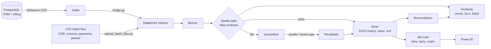

# DataSentinel — Telecom Data Quality & Revenue Assurance Platform

A Databricks lakehouse that ingests telecom CRM, billing, network, partner and app data, checks every record against versioned data contracts, quarantines and replays failing rows, reconciles systems to flag revenue at risk, and turns every finding into a tracked incident with an owner and an SLA.


> **Team project.** Built together with teammates (see [Team](#team)). This repository is my fork of the shared project.


## The problem

A telecom operator's data comes from many systems: a CRM, a billing database, invoice and payment files, network call records (CDRs), partner roaming usage and mobile app events. When those sources disagree or deliver bad data, dashboards become unreliable and money leaks silently: invoices that don't match plan fees, payments with no invoice, usage that is never billed.

## Objectives

- Ingest streaming (CDC) and batch sources into one lakehouse with full history.
- Validate every record against an explicit, versioned **data contract** before it reaches analytics.
- Stop bad data early, but don't lose it: quarantine, auto-fix where safe, let a person fix the rest, then recheck.
- Reconcile systems against each other to detect revenue leakage.
- Make data problems operational: incidents with owners, priorities, SLAs and alerts.
- Serve trusted Gold models to Power BI.

## Architecture



| Layer | What happens | Where |
|---|---|---|
| Sources | PostgreSQL 15 (CRM, billing) and CSV drops (network CDRs, invoice and payment files, partner usage) | `generators/`, `postgres/` |
| Ingestion | Debezium captures Postgres changes into Kafka topics; Python bridges land CDC events and batch files in a Databricks Volume | `debezium/`, `kafka/`, `generators/` |
| Bronze | Raw CDC events and files as Delta tables | `databricks/notebooks/bronze_layer/` |
| Quality gate | Contract rules (schema, completeness, uniqueness, domain, freshness) per dataset, with a circuit breaker that stops the run when the reject rate is too high | `contract/`, `databricks/notebooks/apply_quality/` |
| Quarantine | Failing rows are kept, auto-fixed where a safe fix exists, or corrected in the review app, then revalidated | `apply_quality/21_*`, `22_*`, `review_app/` |
| Observability | Freshness, volume, distribution and schema monitors; late and missing file detection | `apply_quality/30_*`, `33_*` |
| Silver | SCD Type 2 history, cleaning, customer cross-reference and duplicate-customer candidates | `databricks/notebooks/silver_layer/` |
| Reconciliation | Cross-system checks between CRM, billing, network and partner data to flag mismatches and revenue at risk | `silver_layer/60_recon.py` |
| Incidents | Findings become incidents with owner, priority, SLA and Slack alerts; they close when the data is fixed | `databricks/notebooks/incedients/` |
| Gold | dbt star schema (dims, facts) and 13 dashboard marts, with tests including a no-raw-PII check | `dbt/dbt/` |
| Orchestration | Airflow DAG runs the whole chain every 30 minutes | `airflow/dags/sentinel_pipeline.py` |
| Consumption | Power BI report (PBIP) and a Streamlit quarantine review app | `PowerBi/`, `review_app/` |

## Pipeline workflow

The Airflow DAG `sentinel_pipeline` (schedule `*/30 * * * *`, one active run at a time):

```
[bronze_cdc, bronze_batch_files, bronze_app_events]
    -> gate -> autofix -> revalidate -> monitors
    -> silver_history -> silver_clean -> silver_xref -> recon -> incidents -> dbt_build
silver_history -> silver_dupes
late_files -> incidents        (runs even if Bronze loading failed)
gate -> dbt_build              (Gold is not rebuilt when the circuit breaker trips)
```

## Tech stack

| Area | Tools |
|---|---|
| Lakehouse & processing | Databricks, PySpark, Delta Lake, Unity Catalog |
| Ingestion | PostgreSQL, Debezium (CDC), Apache Kafka, Python |
| Transformation | dbt (Databricks adapter) |
| Orchestration | Apache Airflow (Docker) |
| Data quality | YAML data contracts, quality gate, quarantine and revalidation, reconciliation |
| Apps & BI | Streamlit, Power BI (PBIP) |
| Engineering | Docker Compose, pytest, GitHub Actions |

## Repository structure

```
contract/        Versioned data contracts, one YAML per dataset
generators/      Seed data, batch files and upload/bridge scripts
postgres/        Source database setup
debezium/ kafka/ CDC connector and Kafka topics/schemas
databricks/      Bronze, quality, Silver, reconciliation and incident notebooks
dbt/dbt/         Gold layer: staging, dims, facts, marts, tests
airflow/         Dockerised Airflow and the pipeline DAG
review_app/      Streamlit app to fix quarantined rows
src/ tests/      Python twins of the quality, duplicate and SCD2 logic, with unit tests
PowerBi/         Power BI project (PBIP) and theme
docs/            Architecture diagrams, guides and runbooks
```

## Getting started

Prerequisites: Docker, Python 3.10+, a Databricks workspace with a SQL warehouse, and Power BI Desktop for the report.

1. **Configure secrets.** Create a `.env` file in the repo root and in `airflow/` (both are git-ignored) with `DATABRICKS_HOST`, `DATABRICKS_TOKEN` and, for the review app, `DATABRICKS_HTTP_PATH`. Secrets are read from environment variables and are never committed.
2. **Start the sources.** `docker compose up -d` starts PostgreSQL, Kafka and Debezium. Register the connector with `debezium/scripts/register_connector.sh`.
3. **Load data.** Seed Postgres and upload batch files with the scripts in `generators/`.
4. **Run the pipeline.** Start Airflow from `airflow/` (`docker compose up -d --build`, UI on http://localhost:8080) and trigger `sentinel_pipeline`.
5. **Build Gold manually (optional).** See [`dbt/dbt/README.md`](dbt/dbt/README.md).
6. **Review quarantined rows.** See [`review_app/README.md`](review_app/README.md).
7. **Open the report.** Open `PowerBi/model/DataSentinel.pbip` and sign in to Databricks.

Run the tests locally:

```bash
pip install pyyaml pytest
python scripts/validate_contracts.py
python -m pytest -q
```

## Dashboards

The Power BI report has pages for **Overview, Data Quality, Revenue Assurance, Incidents, Customer 360 and Network & App**, plus a customer drill-through page. Guides: [`docs/DataSentinel_dashboards_guide.pdf`](docs/DataSentinel_dashboards_guide.pdf), [`docs/DataSentinel_quarantine_to_silver_guide.pdf`](docs/DataSentinel_quarantine_to_silver_guide.pdf).

More diagrams: [full architecture](docs/architecture/full_architecture.png) · [Gold galaxy schema](docs/architecture/gold_galaxy_schema.png) · [incident flow](docs/architecture/incident_flow.png).

## Team

Built as a team capstone project by:

- [Ahmedalihasaballah](https://github.com/Ahmedalihasaballah) (original repository)
- [Shahdwaleed19](https://github.com/Shahdwaleed19)
- [SAMA-88](https://github.com/SAMA-88)
- [Lina Amer](https://github.com/LinaAmer12)

**My contribution:** I worked on the Medallion lakehouse (Bronze → Silver SCD2 → Gold dbt) with CDC ingestion through Debezium and Kafka, the contract-driven quality gate with its circuit breaker and quarantine flow, the reconciliation rules, the incident routing with Slack alerts, and the Power BI dashboards and Streamlit review app.

---

📫 Lina Amer · [LinkedIn](https://www.linkedin.com/in/linaamer1) · [linaamer1312@gmail.com](mailto:linaamer1312@gmail.com)
